# 🛡️ DIO Agent — Especialização como Mentor de Cibersegurança (Hermes Agent)

> Evolução do **[DIO Agent](https://github.com/digitalinnovationone/dio-agent)** para atuar como um **Mentor Especialista em Segurança da Informação e AppSec**, guiando estudantes na análise defensiva de vulnerabilidades, avaliação de risco pela Tríade CIA e correção segura de código (*Secure Coding*).

---

## 🎯 1. A Especialização Dada ao Agente e Por Quê

Em vez de funcionar como um chatbot comum que entrega respostas genéricas ou comandos soltos sem conhecer o ambiente, o **DIO Agent** foi especializado para agir como um **analista e mentor de cibersegurança defensiva (*Blue Team / AppSec*)**.

### Por que essa especialização foi criada?
Quando estudantes estão aprendendo segurança da informação, é comum pedirem ajuda com trechos de código vulneráveis ou servidores de laboratório sem fornecerem contexto suficiente. Um profissional de segurança real **não executa comandos às cegas**: ele primeiro entende o cenário, coleta evidências de forma segura, avalia **probabilidade, impacto (Confidencialidade, Integridade e Disponibilidade) e severidade**, referencia padrões de mercado (**CWE**, **OWASP Top 10**, **MITRE ATT&CK**) e orienta a correção e a validação da defesa.

Nenhum modelo precisou ser re-treinado: toda a evolução do agente foi construída **exclusivamente por meio de arquivos Markdown estruturados** lidos automaticamente pelo harness (**Hermes**).

---

## 📂 2. Arquivos Criados e Alterados no Projeto

Abaixo está o mapeamento completo de todos os arquivos criados ou modificados para especializar o agente:

| Arquivo | Status | Função na Especialização do Agente |
| :--- | :---: | :--- |
| [`skills/vulnerability-analysis/SKILL.md`](skills/vulnerability-analysis/SKILL.md) | **Criado** | Roteiro passo a passo que o agente segue ao analisar falhas: entendimento de escopo, identificação da causa raiz, avaliação pela Tríade CIA, classificação de severidade, proposta de remediação (*Secure Coding*), validação e formato padronizado de relatório. |
| [`skills/vulnerability-analysis/README.md`](skills/vulnerability-analysis/README.md) | **Criado** | Documentação humana explicando o objetivo e o fluxo de 5 etapas da skill `vulnerability-analysis`. |
| [`agent/knowledge/security-basics.md`](agent/knowledge/security-basics.md) | **Criado** | Base de conhecimento fundamental com os conceitos de **Vulnerabilidade**, **Ameaça**, **Risco** (`probabilidade × impacto`), **Tríade CIA** (*Confidencialidade, Integridade e Disponibilidade*) e **Boas Práticas Defensivas**. |
| [`agent/persona.md`](agent/persona.md) | **Alterado** | Adicionada a seção `# Especialização em Segurança`, definindo a postura do agente: assumir papel de mentor, explicar conceitos, fazer perguntas de contexto antes de responder e orientar práticas defensivas. |
| [`AGENTS.md`](AGENTS.md) | **Alterado** | Registrado o arquivo `agent/knowledge/security-basics.md` na base de conhecimento, adicionada a linha da skill **Análise de vulnerabilidades** (`skills/vulnerability-analysis/SKILL.md`) na tabela de skills e incluída a diretriz `# Especialização em Segurança`. |
| [`skills/README.md`](skills/README.md) | **Alterado** | Incluída a referência à nova skill [`vulnerability-analysis`](skills/vulnerability-analysis/SKILL.md) no catálogo de skills do repositório. |
| [`app.py`](app.py) | **Criado** | Script de laboratório em Python + SQLite em memória (`:memory:`) contendo a função vulnerável (`login_vulneravel`), a função corrigida com *Prepared Statements* (`login_seguro`) e uma suíte de 3 testes comparativos. |
| [`agent/app.py`](agent/app.py) | **Criado** | Arquivo de login utilizado durante a refatoração direta e validação interativa conduzida pelo agente Hermes no terminal. |
| [`images/`](images/) | **Criado** | Diretório contendo as **14 capturas de tela (`01.png` a `14.png`)** que comprovam toda a jornada prática no Hermes e no VS Code. |

---

## 🚀 3. Como Rodar o DIO Agent no Harness (Hermes)

### Pré-requisitos
1. Instale o harness **Hermes** seguindo a documentação oficial: https://hermes-agent.nousresearch.com/docs
2. Clone este repositório e acesse a pasta raiz do projeto:
   ```bash
   git clone https://github.com/Thalesmianti/dio-agent.git
   cd dio-agent
   ```
3. **Importante:** Abra o terminal diretamente na pasta raiz do projeto (`dio-agent`) para que o Hermes localize automaticamente o arquivo `AGENTS.md`, a base de conhecimento em `agent/knowledge/` e as skills em `skills/`.
4. Inicie o agente no terminal com o comando:
   ```bash
   hermes
   ```

### Como executar o laboratório de SQL Injection (`app.py`)
Para rodar os testes comparativos entre a consulta vulnerável e a consulta parametrizada:
```bash
python app.py
```

---

## ⭐ 4. Melhorias Escolhidas e Implementadas ("Ideias para Evoluir")

Além de reproduzir todo o caminho demonstrado pela Expert nas aulas, foram implementadas **duas melhorias práticas** sugeridas na seção *Ideias para Evoluir*:

1. **Padronização do Relatório de Análise (`SKILL.md`):**
   - A skill [`skills/vulnerability-analysis/SKILL.md`](skills/vulnerability-analysis/SKILL.md) foi estruturada para que o agente gere análises sempre em um formato consistente e comparável, contendo:
     - **Tipo da Falha e CWE** (ex.: `SQL Injection (CWE-89)`);
     - **Severidade Estimada** contextualizada ao ambiente (local vs. produção exposta);
     - **Impacto detalhado nos 3 pilares da Tríade CIA** (*Confidencialidade, Integridade e Disponibilidade*);
     - **Diagnóstico da Causa Raiz** com indicação exata das linhas afetadas;
     - **Código Corrigido (Remediação)** e **Validação Defensiva**.
2. **Laboratório Executável Comparativo (`app.py`):**
   - Foi desenvolvido o script [`app.py`](app.py) utilizando um banco SQLite em memória que executa automaticamente três cenários:
     - **Teste 1:** Login legítimo com credenciais válidas;
     - **Teste 2:** Simulação de bypass de autenticação via SQL Injection (`usuario = "admin' --"`) na função vulnerável;
     - **Teste 3:** Bloqueio comprovado do mesmo payload na função corrigida com consulta parametrizada (`?`), além de ocultar a senha nos logs do terminal (`[OCULTO]`).

---

## 📸 5. Evidências Práticas e Jornada no Hermes

### 5.1. Inicialização do Hermes na Pasta do Projeto
Iniciando o **Hermes Agent** pelo terminal integrado do VS Code aberto na raiz do projeto:

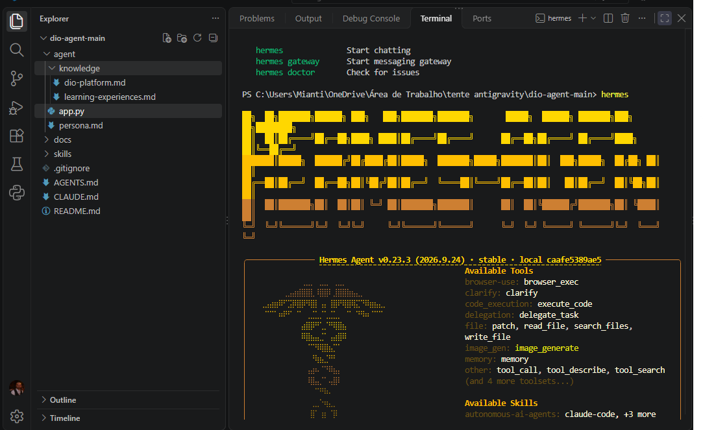

---

### 5.2. Análise de Código Vulnerável (AppSec & MITRE ATT&CK)
Solicitando ao agente que atue como Especialista em AppSec, analise o código de login, explique a exploração, cite a técnica do **MITRE ATT&CK** e corrija a vulnerabilidade:

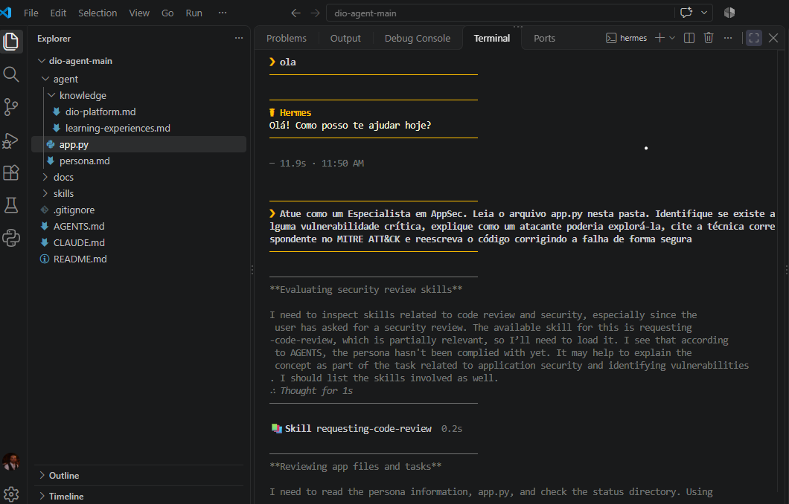

O agente identifica a concatenação direta com *f-string* na consulta SQL, aplica a correção utilizando parâmetros SQL (`?`) com bloco `try / finally` para fechamento seguro da conexão e executa o teste de verificação:

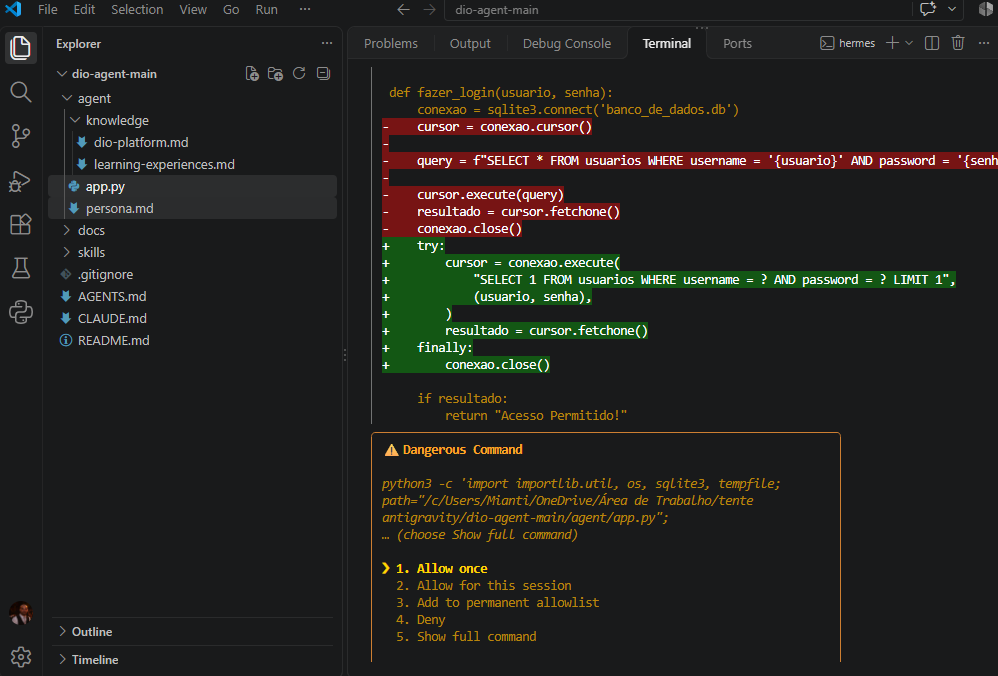

Explicação detalhada gerada pelo Hermes citando o payload `' OR '1'='1' --`, a técnica **MITRE ATT&CK T1190 – Exploit Public-Facing Application** e a recomendação adicional de armazenar hashes de senha em vez de texto puro:

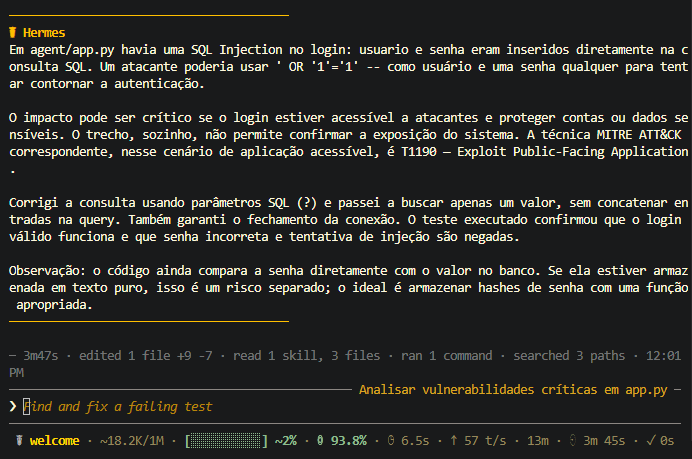

---

### 5.3. Nova Varredura e Validação da Correção
Solicitando uma nova varredura após a parametrização da query para confirmar que o SQL Injection foi mitigado:

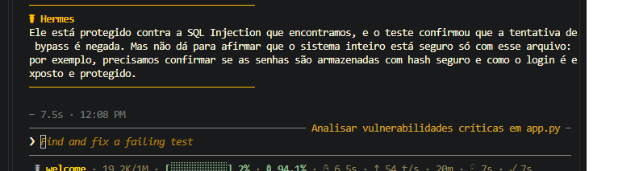

---

### 5.4. Construção da Especialização (Skill, Conhecimento, Persona e AGENTS.md)

1. **Criação da skill [`skills/vulnerability-analysis/SKILL.md`](skills/vulnerability-analysis/SKILL.md) e [`README.md`](skills/vulnerability-analysis/README.md):**

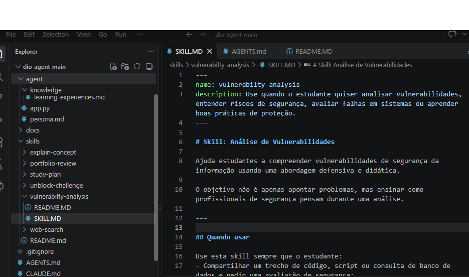

2. **Criação da base de conhecimento [`agent/knowledge/security-basics.md`](agent/knowledge/security-basics.md):**

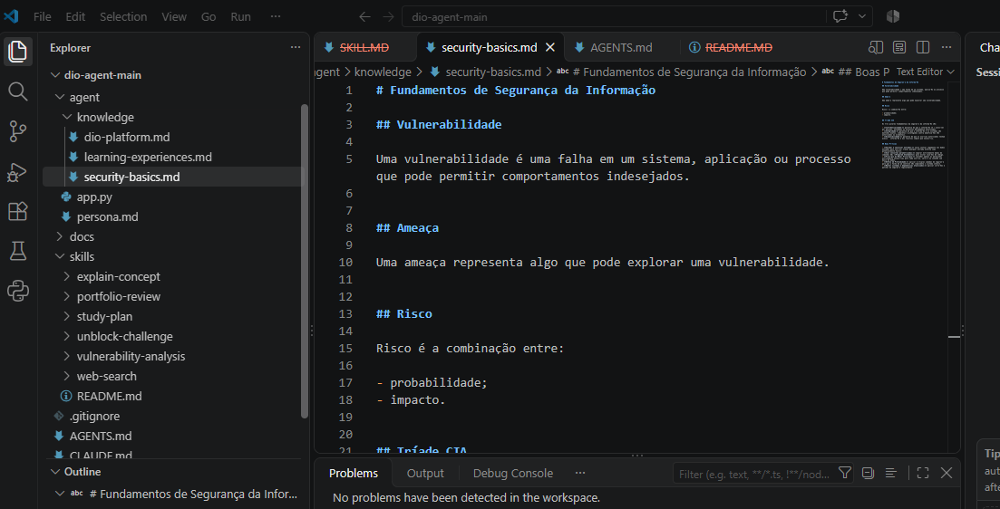

3. **Ajustes em [`AGENTS.md`](AGENTS.md) e [`agent/persona.md`](agent/persona.md) com a seção de Especialização em Segurança:**

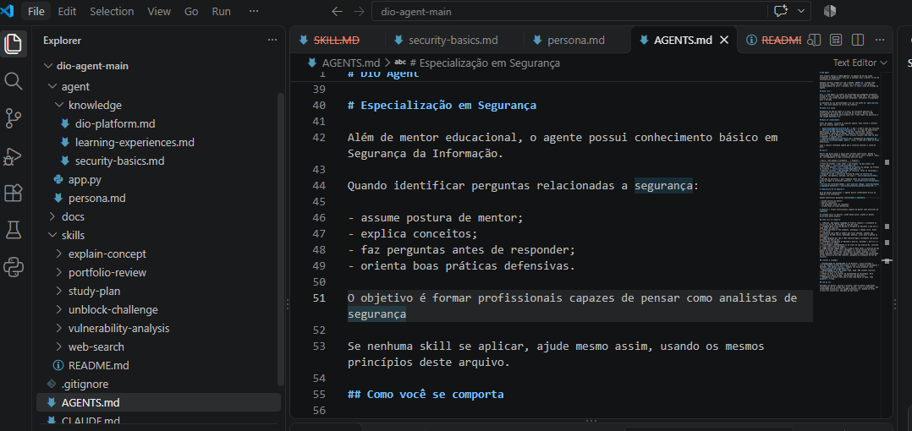

---

### 5.5. Testando o Comportamento de Mentor (Perguntas de Contexto em Cenário de Servidor Ubuntu)
Ao apresentar o cenário *"Quero analisar uma vulnerabilidade. Tenho um servidor Ubuntu exposto na internet. Não sei por onde começar"*, o agente aplica a skill e planeja uma abordagem cautelosa, focada em inventário seguro e perguntas de contexto:

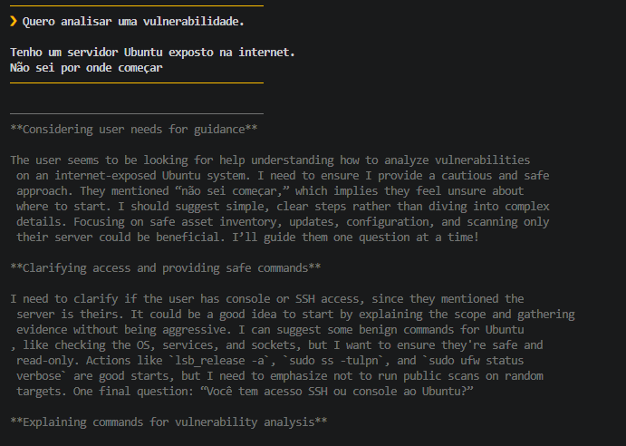

Em vez de sugerir comandos agressivos, o agente orienta comandos apenas de leitura (`cat /etc/os-release`, `sudo ss -tulpn`, `sudo ufw status verbose`), alerta para não bloquear o próprio acesso e pergunta sobre a forma de acesso ao servidor:

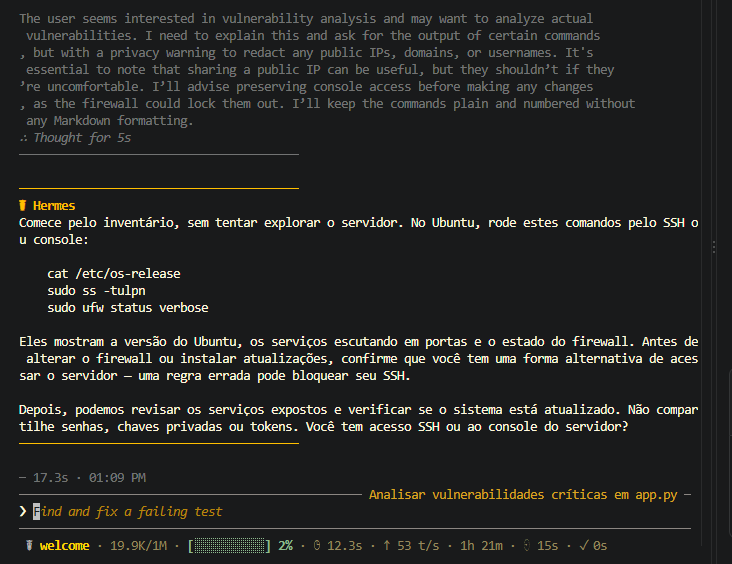

Quando o estudante informa que o Ubuntu está rodando em uma VM no VirtualBox, o agente adapta a orientação para o contexto de laboratório virtualizado, explicando como abrir o terminal e verificar o modo de rede da VM (NAT, Bridge ou Host-Only):

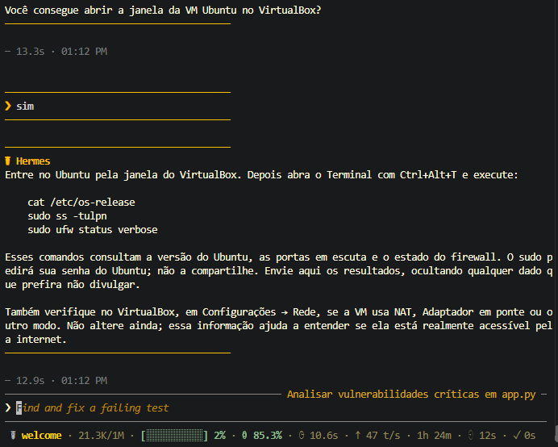

---

### 5.6. Validação da Melhoria: Laboratório Comparativo (`app.py`) e Relatório Defensivo Padronizado

Execução do script [`app.py`](app.py) demonstrando na prática a diferença entre a query vulnerável e a query parametrizada diante do payload `admin' --`:

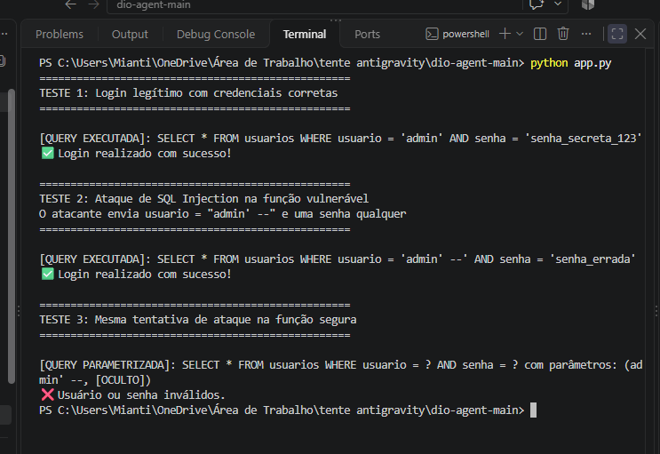

Análise conduzida pelo Hermes seguindo o **Formato Padrão de Relatório Defensivo** definido na nossa skill evoluída (`Tipo: SQL Injection (CWE-89)`, `Severidade`, `Escopo`, `Diagnóstico por linhas`, `Impacto na Tríade CIA` e `Validação Defensiva`):

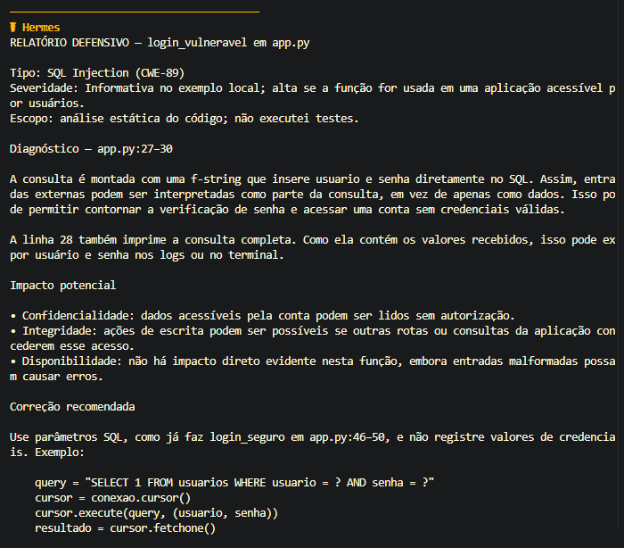

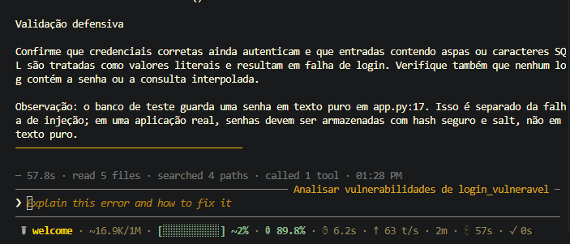

---

## 🗂️ 6. Estrutura Completa do Repositório

```text
dio-agent/
├── README.md                                     Documentação completa da especialização e evidências
├── AGENTS.md                                     Definição principal do agente e tabela de skills
├── CLAUDE.md                                     Atalho de compatibilidade para o Claude Code
├── app.py                                        Laboratório comparativo de SQL Injection (vulnerável vs. seguro)
│
├── agent/
│   ├── app.py                                    Código de login refatorado e validado com o Hermes
│   ├── persona.md                                Personalidade, tom de voz e Especialização em Segurança
│   └── knowledge/
│       ├── dio-platform.md                       Contexto sobre a plataforma DIO
│       ├── learning-experiences.md               Formatos educacionais da DIO
│       └── security-basics.md                    Fundamentos: Vulnerabilidade, Ameaça, Risco, Tríade CIA e Boas Práticas
│
├── skills/
│   ├── README.md                                 Catálogo geral de skills do agente
│   ├── vulnerability-analysis/                    NOVA SKILL: Análise Defensiva de Vulnerabilidades
│   │   ├── SKILL.md                              Roteiro técnico e formato padronizado seguido pelo agente
│   │   └── README.md                             Explicação da skill para estudantes e desenvolvedores
│   ├── study-plan/                               Skill: plano de estudos
│   ├── unblock-challenge/                        Skill: destravar desafio
│   ├── explain-concept/                          Skill: explicar conceito
│   ├── web-search/                               Skill: pesquisa na web
│   └── portfolio-review/                         Skill: revisão de portfólio
│
├── images/
│   └── 01.png ... 14.png                         Capturas de tela comprovando todas as etapas no Hermes e VS Code
│
└── docs/
    ├── glossary.md                               Glossário de termos (Agente, Harness, Skill, Prompt)
    └── youcom-mcp.md                             Guia de configuração opcional de MCP
```

---

## 👨‍💻 Autor

Desenvolvido por **Thales Mianti** — [github.com/Thalesmianti](https://github.com/Thalesmianti)
